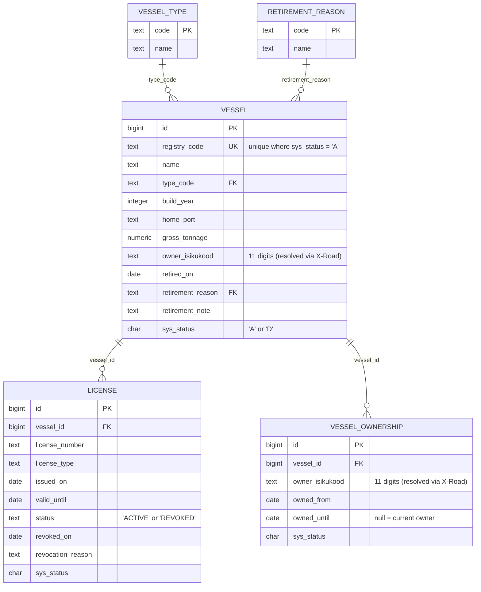

# ITE4120 — Vessel and License Register

Welcome to the **Vessel and License Register** project repository for ITE4120. This documentation is organized into two primary sections:

1. **[Part 1: Our Solution — Vessel and License Register](#part-1-our-solution--vessel-and-license-register)**: Overview of our component, the maritime user story, context, acceptance criteria, and target architecture.
2. **[Part 2: Course Template & Technical Guide](#part-2-course-template--technical-guide)**: Local setup instructions, running the backend and frontend, test suites, toolchain installation, and GitHub token configuration.

---

## Part 1: Our Solution — Vessel and License Register

Our team's project component is the **Vessel and License Register** (`ee.taltech.ite4120.vessels`). It delivers a state register for maritime watercraft, commercial ships, and recreational vessels for maritime administration authorities (Transpordiamet / Veeteede Amet), together with their operational and safety licenses.

### User Stories & Requirements

> **Traces to:** [VESSELS-US-001](docs/src/user-stories/VESSELS-US-001.md) (Registration & Lookups) · [VESSELS-US-002](docs/src/user-stories/VESSELS-US-002.md) (License Validity & Expiries) · [VESSELS-US-003](docs/src/user-stories/VESSELS-US-003.md) (Ownership Transfer) · [VESSELS-US-004](docs/src/user-stories/VESSELS-US-004.md) (Vessel Retirement) · [VESSELS.01 Specification](docs/src/specifications/VESSELS.01-vessel-register.md)

Our solution spans four key business capabilities:
1. **VESSELS-US-001 · Registration & Search**: Maritime administration officers register vessels with unique registry codes, maintain essential characteristics, look up live owner identities via X-Road, and issue licenses.
2. **VESSELS-US-002 · License Validity & Expiries**: Operational licenses have dynamically derived effective statuses (`VALID`, `EXPIRING_SOON`, `EXPIRED`, `NOT_YET_VALID`, `REVOKED`), support formal revocation with reasons, and feed an expiring licenses view (default within 30 days).
3. **VESSELS-US-003 · Ownership Transfer**: Vessel ownership changes are recorded as dated periods (`vessel_ownership`), maintaining complete audit history. New owner personal codes are validated live against the population registry before transfer (fail-closed).
4. **VESSELS-US-004 · Recorded Retirement**: Decommissioned, scrapped, lost, or re-flagged vessels undergo formal recorded retirement, atomically soft-deleting the vessel, freeing its registry code for reuse, automatically revoking active licenses, and freezing further mutations.

### Context & Problem Statement

The Estonian maritime administration maintains official state records of all water craft, recreational vessels, and commercial ships:
- **Official Registry Code**: Each vessel is registered under a unique national or international registry code. Codes of retired vessels can be safely reused.
- **One Source of Truth (Estonian E-Government Architecture)**: The owner of the vessel is **never** duplicated as free-text data in the vessel register. The register stores only the owner's personal identification code (`isikukood`, exactly 11 digits as a string) and resolves the owner's full name and address live from the Estonian population registry over X-Road (imitated via an external registry adapter in development).
- **Dual External Registry Failure Policy**:
  - *Fail-open on queries*: If the population registry adapter is temporarily unavailable, read endpoints return 502 Bad Gateway for owner details while vessel records, licenses, and ownership history remain fully accessible and operable.
  - *Fail-closed on owner registration & transfers*: Whenever an owner personal code is recorded (on initial vessel registration, first-owner assignment, or ownership transfer), registry availability and live validation of the owner's code are mandatory; unknown codes are refused with 400 Bad Request, and if the registry is unreachable, the operation is refused with 502 Bad Gateway.
- **Dynamic License Lifecycle**: Validity is calculated on-the-fly from issue and expiration dates and revocation status. An officer can revoke valid licenses with mandatory reason and date.
- **Auditable Ownership & Retirement**: Ownership is tracked across dated periods. Retiring a vessel preserves all historical records for inspection while preventing new operations.

### Key Acceptance Criteria & Business Rules

1. **Vessel Registration & Code Reuse**:
   - Vessels are registered with a unique registry code, name, vessel type, and optional build year, home port, gross tonnage, and owner code.
   - A registry code identifies exactly one **active** vessel (`where sys_status = 'A'`). The registry code of a retired (soft-deleted) vessel may be reused.
2. **Input Validation**:
   - Unknown vessel types or retirement reasons are rejected with `400 Bad Request`.
   - Build year cannot be in the future (e.g. greater than the current year).
   - Owner personal code must be formatted as exactly 11 numeric characters (stored as a string, never a number).
   - *Design decision on `isikukood` checksum*: Strict Estonian Modulo-11 (EVS 585) control-digit validation was considered and deliberately omitted so the application remains compatible with the template's mock population registry and seeded demo dataset (`38102130265`, `47503121234`, `50011020017`), in which two of the three synthetic person codes use illustrative trailing digits rather than Modulo-11 check digits.
3. **License Constraints & Effective Status**:
   - Maritime licenses include a license number, license type, issue date, expiration date (`valid_until`), and status (`ACTIVE` or `REVOKED`).
   - A license whose expiration date precedes its issue date (`valid_until < issued_on`) is refused with `400 Bad Request`.
   - A valid license can be revoked once with a date and reason; revoking an already expired or revoked license is refused with `409 Conflict`.
   - A scheduled license that has not yet taken effect (`NOT_YET_VALID`, `issued_on > today`) can be cancelled via `DELETE` (`204 No Content`), whereas active, expired, or revoked licenses cannot be deleted (`409 Conflict`).
   - Expiring licenses view excludes retired vessels.
4. **Ownership Transfer & Registry Verification**:
   - Transferring ownership closes the active period and opens a new period in `vessel_ownership`.
   - The new owner's personal code is validated live; unrecognised codes or transfers to the current owner are refused with `400 Bad Request`.
   - Unreachable registry refuses the transfer with `502 Bad Gateway`.
5. **Retirement Integrity**:
   - Retiring a vessel (`DELETE /api/vessels/{id}`, `204 No Content` soft delete) requires a date, valid reason, and note if reason is `OTHER`.
   - Retirement automatically revokes all currently valid licenses with reason "Vessel retired".
   - Retired vessels are frozen: updates, license issuance, and ownership transfers are refused with `409 Conflict`.

### Component Layers & Architecture

| Layer | Location | Purpose |
| --- | --- | --- |
| **Specification & Documentation** | [`docs/src/specifications/VESSELS.01-vessel-register.md`](docs/src/specifications/VESSELS.01-vessel-register.md) | Single unified mdBook spec defining data model, REST API endpoints, business rules, and UI layout |
| **Data Layer (PostgreSQL + Liquibase)** | `backend/src/main/resources/vessels/db/changelog/` | Schema `vessels` with tables `vessel_type`, `retirement_reason`, `vessel`, `license`, and `vessel_ownership` |
| **API Layer (Spring Boot + springdoc)** | `backend/src/main/java/ee/taltech/ite4120/vessels/` | REST controllers, service layer, repository (`BaseRepository`), Problem Details errors |
| **Registry Adapter** | `backend/src/main/java/ee/taltech/ite4120/animals/ownerregistry/` | Shared live population registry adapter (Mock X-Road `/mock-registry` & `forge-xroad`) with wire records and mapper |
| **UI (React + @helex/ui)** | `frontend/src/vesselsApi.ts`, `frontend/src/pages/vessels/`, `frontend/src/pages/licenses/` | Vessel list (`ResourceList` with direct Edit action), vessel detail (`ResourceForm` + `useDataController`), and expiring licenses list |

### Database Schema Visualization (`vessels` only — SchemaSpy & Mermaid ER Diagram)

The `vessels` schema is isolated from the course template's `animals` and `core` schemas and consists of 2 reference tables (`vessel_type`, `retirement_reason`) and 3 business tables (`vessel`, `license`, `vessel_ownership`):



#### Interactive SchemaSpy Report (`-s vessels`)
* **On GitHub (CI / GitHub Pages)**: The workflow [`.github/workflows/schemaspy.yml`](.github/workflows/schemaspy.yml) starts PostgreSQL, runs the Liquibase migrations, and executes **SchemaSpy** (`schemaspy/schemaspy:latest`) with `-s vessels` (analyzing **only** the `vessels` schema). It uploads the full interactive HTML site and Graphviz ER diagrams (`relationships.real.large.png`) as the **`schemaspy-vessels-report`** workflow artifact and deploys it to **GitHub Pages** on `main` (or via manual *Run workflow*).
* **Locally**: Once the backend has started at least once (`./scripts/run-backend.sh`), run:
  ```bash
  ./scripts/run-schemaspy.sh        # Windows: .\scripts\run-schemaspy.ps1
  ```
  This generates and opens `docs/schemaspy/index.html` in your browser.

Full documentation is available in the mdBook documentation suite (run `scripts/run-docs.sh` to serve locally).

---

## Part 2: Course Template & Technical Guide

This project is built using the ITE4120 course template. The reference implementation provided with the template is the **animals register** (`ee.taltech.ite4120.animals`), which provides the architectural conventions and working examples for our vessel component.

Everything Helex arrives as **published packages** — there is no platform source checkout here and none is needed.

| Layer | Where | Session |
| --- | --- | --- |
| Specification | `docs/src/` (mdBook) | S1 |
| Data — PostgreSQL + Liquibase | `backend/src/main/resources/animals/db/` | S2 |
| API — Spring Boot + springdoc | `backend/src/main/java/.../animals/` | S3 |
| Registry adapter (mock + X-Road) | `.../animals/ownerregistry/` | S3 |
| UI — React + @helex/ui | `frontend/src/` | S4 |

The UI wears the **TalTech theme** — the `taltech` pack from
`helex-solutions/helex-extensions`, registered in `frontend/src/theme/taltech.ts`
and selected by `VITE_THEME` in `frontend/.env` (the @helex/ui built-ins
`helex`, `tedi`, `matrix` work there too).

### Run it

First time on this machine? Install the toolchain and the GitHub Packages
token first — [§ Tools](#tools), at the end of this file. Then:

```bash
# 1. database + backend  (first run downloads dependencies — takes a few minutes)
./scripts/run-backend.sh          # Windows: .\scripts\run-backend.ps1

# 2. frontend, in a second terminal  (npm needs the token too — § Tools › GitHub token)
cd frontend && npm install && cd ..
./scripts/run-frontend.sh         # Windows: .\scripts\run-frontend.ps1
```

| What | Where |
| --- | --- |
| The application | http://localhost:18640 |
| Swagger UI — the live API contract | http://localhost:18440/swagger-ui.html |
| The imitated population registry | http://localhost:18440/mock-registry/persons/38102130265 |
| PostgreSQL | localhost:18520 · `scripts/psql` for a shell |
| The documentation book | `scripts/run-docs` → http://localhost:18740 (needs [mdBook](https://rust-lang.github.io/mdBook/guide/installation.html), no Docker) |

Signed in automatically as a mock user; the API accepts
`Authorization: Bearer <any-username>` in local mode. The database is
disposable: `scripts/reset-db` destroys and recreates it, and Liquibase
rebuilds the schema on the next backend start.

### Tests

```bash
cd backend && ./gradlew test      # business tests, against a throwaway PostgreSQL
```

The tests in `AnimalBusinessRulesIT` are the specification's business tests,
executable — and they also prove the migrations run clean from empty.

#### Vessels backend and the mock X-Road registry

The vessels API (`/api/vessels`, `/api/licenses`; contract in Swagger UI and
[VESSELS.01](docs/src/specifications/VESSELS.01-vessel-register.md)) lives in
`ee.taltech.ite4120.vessels` (`api` → `service` → `repository`). Owner lookups and
ownership transfers go through the shared `OwnerRegistryAdapter`: locally it calls this
app's own mock registry (`/mock-registry/persons/{isikukood}`, known codes `38102130265`,
`47503121234`, `50011020017`); `animals.owner-registry.mode=xroad` switches to the
forge-xroad transport with no code change. Owner reads **fail open** (502 on that
endpoint only); a transfer **fails closed** (registry down → 502, nothing saved).
`VesselBusinessRulesIT` (spec business tests, registry mocked) and `VesselApiIT`
(real HTTP against the built-in mock registry) cover it.

#### Testing the vessels database layer

**What is used:** JUnit 5 + AssertJ (via `spring-boot-starter-test`), Spring Boot
test context, and **Testcontainers** — each integration test class starts a
throwaway `postgres:18-alpine` container, Liquibase applies the *whole* changelog
(core + animals + vessels + demo data) to it from empty, and the container is
destroyed afterwards. Your local database (`scripts/run-backend`) is never touched,
so tests are safe to run any time. **Docker must be running** (see § Tools).

| Test class (`backend/src/test/java/ee/taltech/ite4120/vessels/`) | Kind | What it proves |
| --- | --- | --- |
| `VesselDataLayerIT` | integration, needs Docker | migrations run clean; reference lists seeded; `sys_*` trigger columns; registry-code uniqueness among active rows and reuse after retirement; every CHECK/FK constraint of `vessel`, `license`, `vessel_ownership` refuses bad data; search/filter/paging; license revocation, history, retirement cascade and expiring list; ownership periods (one open period, transfer) |
| `LicenseEffectiveStatusTest` | plain unit test, no Docker | derived license status (`VALID`, `EXPIRING_SOON`, `EXPIRED`, `NOT_YET_VALID`, `REVOKED`) incl. boundary days 0/30/31 |
| `VesselFrontendTest` | frontend unit, contract & `tsc -b`, no Docker | runs all 10 tests in `frontend/src/vesselsApi.test.ts` as JUnit dynamic tests, verifies UI routes/Edit action/`DELETE` retirement contract, and runs TypeScript typecheck (`tsc -b`) |

The rules are taken from [VESSELS.01](docs/src/specifications/VESSELS.01-vessel-register.md)
(data model + business tests); if you change a rule, change the spec in the same PR.

```bash
cd backend

./gradlew test                                          # everything (animals + vessels)
./gradlew test --tests '*VesselDataLayerIT'             # only the vessels data-layer tests
./gradlew test --tests '*LicenseEffectiveStatusTest'    # only the fast unit test (no Docker)
./gradlew test --tests '*VesselDataLayerIT.registryCodeIsUniqueAmongActiveVesselsAndReusableAfterRetirement'   # one test
./gradlew test --rerun                                  # force a rerun even if nothing changed
```

Reports: `backend/build/reports/tests/test/index.html` (open in a browser) and
XML in `backend/build/test-results/test/`. Two more checks that belong to the
database layer and run on every PR:

```bash
scripts/check-changesets          # formatted-SQL grammar of every changelog (rule 6)
scripts/reset-db                  # manual: drop local DB; next backend start replays all changesets
```

**Manual check against the real local database** — start the backend
(`scripts/run-backend`), then `scripts/psql` and try e.g.:

```sql
select registry_code, name, sys_status from vessels.vessel order by id;
select license_number, status, valid_until from vessels.license where vessel_id = (select id from vessels.vessel where registry_code = 'EST-1001');
-- must FAIL (constraint): insert into vessels.vessel (registry_code, name, type_code) values ('X', 'X', 'NOPE');
```

**Troubleshooting:** *"Could not find a valid Docker environment"* → start Docker
Desktop (or, with Colima, export `DOCKER_HOST`/`TESTCONTAINERS_DOCKER_SOCKET_OVERRIDE`
as shown in § Tools). *"cannot resolve org.helex.emr"* → GitHub token (§ GitHub token).

#### Testing the vessels frontend

The frontend verification suite consists of TypeScript project typechecking (`tsc -b`), the Vite production bundle build, and executable Node unit/contract tests (`frontend/src/vesselsApi.test.ts`) verifying domain rules (`isCurrentlyValid`, `isRetired`, license compliance summary, expiring list filtering), all `vesselsApi` endpoints (including `DELETE /api/vessels/{id}` soft-delete retirement and `DELETE /api/vessels/{id}/licenses/{licenseId}` scheduled license cancellation), mock bearer authentication headers, and RFC 9457 `application/problem+json` error handling:

```bash
# Run frontend tests via Gradle (unified JUnit runner, no Docker needed):
cd backend && ./gradlew test --tests '*VesselFrontendTest' --console=plain

# Or directly via npm inside frontend/:
cd frontend
npm test             # run frontend unit & API contract tests (src/vesselsApi.test.ts)
npm run typecheck    # TypeScript typecheck (tsc -b)
npm run build        # full typecheck + production bundle build
```

The same tests, the frontend typecheck and build, and the changeset gate run on
every pull request as the **Verify** checks (`.github/workflows/verify.yml`);
they need nothing from you beyond the repository itself. A copy of this
repository whose Actions token cannot read the Maven mirror adds a `GPR_TOKEN`
repository secret (the same classic token as in § Tools).

### Your component

1. Copy `docs/_templates/` → write your user story and specification (different
   domain from animals!).
2. New package `ee.taltech.ite4120.<yours>`, new schema, new changelog folder,
   one include added to the master changelog.
3. Follow the animals example file-by-file; the shape is the deliverable.
4. Rules of the road: `AGENTS.md` (for your agent — and for you). Claude Code,
   Cursor, Copilot and Gemini are all pointed at that one file; use whichever.

### Reading order

`docs/src/README-docs.md` → the animals story and spec in `docs/src/` →
the three manuals in `docs/src/manuals/` (database, REST API, frontend) →
`docs/src/liquibase-guide.md` → `docs/src/development-workflow.md`. Or serve the
book with live reload: `scripts/run-docs` (`.sh` / `.ps1`).

### Tools

What the scripts and builds in this repository actually call, and why:

| Tool | Version | Used for |
| --- | --- | --- |
| **Git** | any recent | clone, branch, PR — your contribution is the history under your name (gate B) |
| **Docker Desktop** (or a compatible engine with `docker compose`) | running | PostgreSQL locally (`scripts/run-backend`, `reset-db`, `psql`); a throwaway PostgreSQL in the tests (Testcontainers) |
| **JDK 25** | 25 | the Gradle wrapper runs on it *and* compiles with it — nothing downloads a JDK for you (no toolchain resolver is configured), so it must be installed |
| **Gradle** | 9.4 | provided by the wrapper: `backend/gradlew` downloads the pinned version on first use. Nothing to install; a second, system-wide Gradle only invites version mix-ups |
| **Node.js** + npm | 20+ | the Vite frontend (`scripts/run-frontend`, `npm ci`, `npx tsc -b`) |
| **Python 3** | 3.x | `scripts/check-changesets` — the formatted-SQL grammar gate (rule 6 in `AGENTS.md`) |
| **GitHub account** + token with `read:packages` | — | the Helex packages live in GitHub Packages, which refuses anonymous reads |
| GitHub CLI `gh` | optional | pull requests from the terminal; not needed for the token |
| mdBook | optional | serves `docs/` as a book — `scripts/run-docs` |

No local `psql` needed — `scripts/psql` runs it inside the container.

Docker engines other than Docker Desktop (Colima, Rancher Desktop, Podman) work
for running the app, but the tests need to be told where the socket is — with
Colima: `export DOCKER_HOST=unix://$HOME/.colima/default/docker.sock
TESTCONTAINERS_DOCKER_SOCKET_OVERRIDE=/var/run/docker.sock` before
`./gradlew test`.

#### Install with a package manager

One script per platform, idempotent, safe to re-run. Each installs the
package manager itself if it is missing, then the rows above, then prints a
version check:

```bash
# macOS — Homebrew
./scripts/setup-tools.sh
```

```powershell
# Windows — Chocolatey, in PowerShell run as Administrator
.\scripts\setup-tools.ps1
```

By hand, the same thing:

| | macOS (Homebrew) | Windows (Chocolatey) |
| --- | --- | --- |
| Git, GitHub CLI | `brew install git gh` | `choco install -y git gh` |
| JDK 25 | `brew install openjdk@25` — keg-only: register it with `sudo ln -sfn "$(brew --prefix openjdk@25)/libexec/openjdk.jdk" /Library/Java/JavaVirtualMachines/openjdk-25.jdk` | `choco install -y temurin25` (sets `JAVA_HOME` and `PATH`) |
| Node.js + npm | `brew install node` | `choco install -y nodejs-lts` |
| Python 3 | `brew install python` | `choco install -y python` |
| Docker Desktop | `brew install --cask docker-desktop` | `choco install -y docker-desktop` — needs WSL 2: `wsl --install` once, reboot |
| mdBook (optional) | `brew install mdbook` | no Chocolatey package — see the [mdBook installation guide](https://rust-lang.github.io/mdBook/guide/installation.html) |

Windows notes: run the repository's PowerShell scripts as `.\scripts\name.ps1`;
if PowerShell refuses to run scripts, `Set-ExecutionPolicy -Scope CurrentUser
RemoteSigned` once. Docker Desktop must be started once by hand after install
(it finishes the WSL 2 setup on first start). winget and Scoop carry the same
packages if you prefer them.

#### GitHub token

The one step nothing works without: the Helex packages live in GitHub
Packages, which refuses anonymous reads.

**Create the token** at
**[github.com/settings/tokens/new — pre-filled for this project](https://github.com/settings/tokens/new?description=ITE4120+Helex+packages+read-only&scopes=read:packages)**
— the form opens with exactly the one scope this project needs; pick an
expiration, press *Generate token*, copy it once. From a terminal:

```bash
open "https://github.com/settings/tokens/new?description=ITE4120+Helex+packages+read-only&scopes=read:packages"
```

(Windows: paste the URL into the browser, or `start ""` instead of `open`.)
It must be a **classic** token: GitHub's Maven and npm registries do not
accept fine-grained tokens. `read:packages` alone is the minimum privilege —
it can download packages your account can see, and nothing else.

**Both package managers need it.** Gradle reads it from
`~/.gradle/gradle.properties`; npm reads it from its global config — and
GitHub's npm registry refuses anonymous reads **even for public packages**,
so `npm install` in `frontend/` fails with a 401 until this has run once:

```bash
npm config set //npm.pkg.github.com/:_authToken=ghp_YOUR_TOKEN --global
```

**Wire it in** — one paste, silent prompt, no token in your shell history
(macOS/Linux; on Windows edit the two files by hand as shown below):

```bash
read -s TOKEN && printf 'gpr.user=%s\ngpr.key=%s\n' "YOUR_GITHUB_USERNAME" "$TOKEN" >> ~/.gradle/gradle.properties && npm config set "//npm.pkg.github.com/:_authToken=$TOKEN" --global && unset TOKEN
```

What that writes, if you prefer to do it by hand:

```properties
# ~/.gradle/gradle.properties  (backend)
#   Windows: %USERPROFILE%\.gradle\gradle.properties
gpr.user=YOUR_GITHUB_USERNAME
gpr.key=ghp_YOUR_TOKEN
```

```bash
# npm (frontend) — one command, same on Windows:
npm config set //npm.pkg.github.com/:_authToken=ghp_YOUR_TOKEN --global
```

Missing or wrong token looks like this: Gradle says *cannot resolve
org.helex.emr:…*, npm says *401*. Fix the credentials first — never vendor
jars. No other access is needed: the backend's Helex jars resolve from THIS
repository's own Maven registry (mirrored by the lecturer with
`scripts/mirror-packages.sh`), and the `@helex-solutions` npm packages are
public — GitHub's npm registry still wants the token to read them, but no
extra permission. A correct token that still gets 401/403 means the token is
expired or you have not accepted the invitation to this repository; ask the
lecturer.
